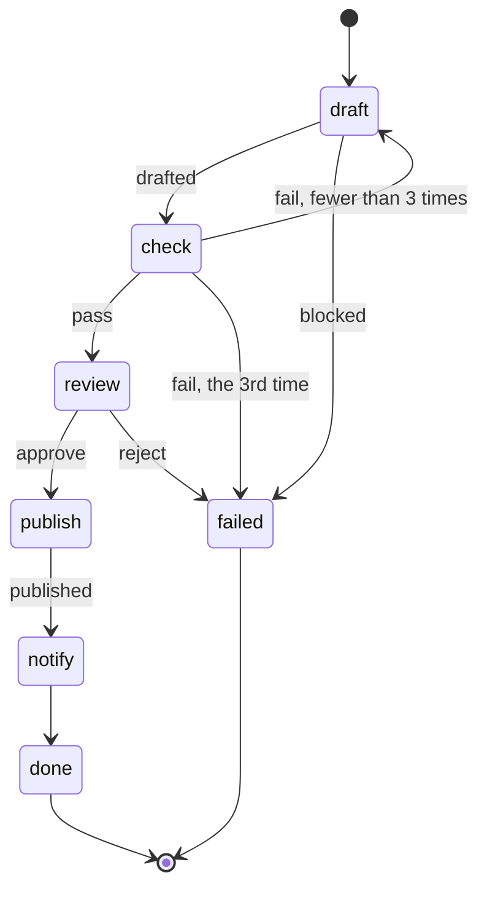

# sekaisen

*世界線, "world line": every run follows one line through its pipeline, and the log is that line.*

sekaisen runs multi-stage work across AI agents that live in an external harness: a coding agent
such as Claude Code or Codex, an agent gateway, anything that can take a turn and call a tool. Each
pipeline is one YAML file: its stages, the outcomes each stage may end with, and where each outcome
leads. The engine dispatches a turn and returns at once; the run resumes when the agent calls
`stage_complete` with one of the declared outcomes. A stage can outlive a turn, a process or a
restart, and every step is written to an append-only transition log.

- **Durable dispatch-and-await.** Runs survive restarts: on start the engine reconciles every
  in-flight turn and retries what was lost.
- **Typed completion.** Agents finish a stage by naming a declared outcome with validated fields.
  A wrong outcome is a tool error while the turn is still alive, not a silent wrong turn.
- **Checks before a run.** Schema, references, reachability, bounded loops, required human gates and
  timing limits are checked before anything is dispatched.
- **Simulation.** Exercise every path against scripted outcomes on a virtual clock, with transition
  coverage, spending no tokens.
- **A scheduler for scarce agents.** Per-agent work limits, a global lane cap, priorities and
  fairness, and a pause when a provider's usage limit is hit.
- **A2A-aligned states.** Stage runs use the A2A task states, so exposing a pipeline as an agent is a
  mapping, not a rewrite.

**Status:** pre-0.1. The design is done and the engine is being built in the open. It requires
Node ≥ 22.13, runs on one host and stores its state in SQLite. It is not a distributed workflow
engine. There is no visual editor, and stages cannot run in parallel yet.

[](LICENSE)
[](#roadmap)
[](#roadmap)
<!-- The npm and CI badges arrive with 0.1, when there is a package and a workflow to point at. -->

[How it works](#how-it-works) ·
[Roadmap](#roadmap) ·
[Non-goals](#non-goals) ·
[Design](docs/design.md) ·
[Adapters](docs/adapter.md) ·
[OpenClaw](docs/openclaw.md) ·
[Contributing](#contributing) ·
[Security](#security)

> [!IMPORTANT]
> **Nothing to install yet.** The core engine and its CLI are built, but nothing is published yet: there is no npm
> package. The format, the commands and the interfaces below are **planned for
> 0.1**, and may change before it ships. Watch the repository to follow the first release.

## How it works

A pipeline is a YAML file. This one drafts a document, has it checked, asks a person before
publishing, and sends a notice:

```yaml
format: 1
id: release-notes
title: Draft, check and publish release notes
version: 1
inputs:
  type: object
  properties: { tag: { type: string } }
  required: [tag]
defaults:
  deadline: 30m
  retry: { max: 1, on: [no_result, lost] }
start: draft
stages:
  draft:
    type: agent
    agent: drafter
    session: run
    brief: briefs/draft.md
    outcomes:
      drafted: { fields: { doc: string }, next: check }
      blocked: { fields: { reason: string }, next: failed }
  check:
    type: agent
    agent: checker
    session: run
    brief: briefs/check.md
    outcomes:
      pass: { next: review }
      fail:
        fields: { findings: string }
        next:
          - { if: "count(check.fail) < 3", to: draft }
          - { to: failed }
  review:
    type: gate
    who: operator
    prompt: "Publish the release notes for {{inputs.tag}}?"
    timeout: 24h
    outcomes:
      approve: { next: publish }
      reject: { next: failed }
  publish:
    type: agent
    agent: publisher
    session: run
    brief: briefs/publish.md
    deploys: true
    outcomes:
      published: { fields: { url: string }, next: notify }
  notify:
    type: action
    action: demo.notify
    retry: { max: 2 }
    next: done
  done: { type: end, status: completed }
  failed: { type: end, status: failed }
```

As a state diagram (`sekaisen render` draws one like it):



Before anything runs, `sekaisen check` proves what it can from the file alone. Every stage is
reachable, and every outcome leads somewhere. The draft and check loop is bounded by its
`count()` guard. The `publish` stage, marked `deploys: true`, can only be reached through a gate
that a person resolves. `demo.notify` is an action the host has registered by name; its own
`retry` tries a failed call twice more, since `defaults.retry` names endings an action never has.

At run time the engine:

1. **Admits** the next stage run through the scheduler, which holds it while its agent is busy, the
   lane is full or the provider is paused.
2. **Dispatches** a turn through the harness adapter, with the rendered brief and a completion token
   scoped to this attempt, and returns at once.
3. **Awaits** the agent's `stage_complete` call, or learns from the adapter that the turn ended
   without one, and classifies that ending.
4. **Advances** the run along the outcome's `next`, writing every state change to the transition log
   in the same transaction.

The agent finishes its stage with a typed call:

```text
stage_complete({ token: "…", outcome: "fail", fields: { findings: "The 2.1 heading has no date." } })
```

An outcome the stage does not declare, a missing field or a wrong type is refused while the turn is
still alive, so the agent can correct itself:

```text
unknown outcome "approved". Declared outcomes:
- pass (no fields)
- fail (fields: findings: string)
```

A token from an earlier attempt is dead: a late turn that wakes up after a retry cannot complete the
newer attempt.

### The stage-run lifecycle

A run moves through the pipeline's graph. Each attempt at a stage is a stage run, and each stage run
moves through one fixed lifecycle, using the [A2A](https://a2a-protocol.org/) task states:

| State | A2A task state | Meaning |
|---|---|---|
| `submitted` | `submitted` | Created, waiting to be dispatched or run; also between continuation turns |
| `working` | `working` | A turn is in flight, a wait is running, or a poll gate is polling |
| `input_required` | `input-required` | An operator gate is waiting on a person |
| `completed` | `completed` | Ended with one of its declared outcomes |
| `failed` | `failed` | Ended with an engine-classified ending, or a gate timed out. A retry is a new stage run |
| `canceled` | `canceled` | Canceled with its run |
| `rejected` | `rejected` | Refused before it could run, such as a brief that cannot be rendered |

A run's own status uses the same words: `working`, `input_required`, `completed`, `failed` and
`canceled`. [docs/design.md](docs/design.md) covers the rest: the stage types, the completion
contract, retries, gates, restart reconciliation, the scheduler, simulation and the adapter
interface.

## Roadmap

| Version | Scope | Status |
|---|---|---|
| **0.1** | The format, the checks, the interpreter on SQLite, typed completion, the scheduler, simulation, the conformance suite, the CLI and the first adapter | **In progress** |
| **0.2** | Cost budgets per stage and per pipeline, with a transition when a budget runs out. An XState export | Planned |
| **0.3** | Crystallization reports: decision points whose outcome never varies in the transition log, with the evidence, as candidates to turn into code | Planned |
| **0.4** | Subpipelines: a pipeline as one stage of another. Each pipeline exposed as an A2A agent with its own agent card, and an A2A adapter for remote agents | Planned |
| Later | Parallel stages (format 2), Postgres and libSQL stores, more harness adapters | Ideas |

The road to 0.1:

- [x] **Format 1.** The `agent`, `gate`, `check`, `action`, `wait` and `end` stage types, a published
      JSON Schema, a small guard language and brief templates.
- [x] **Checks.** Schema, references, graph, termination, policy and timing, plus a hook for checks the
      host adds. `sekaisen check`.
- [x] **Rendering.** Mermaid state diagrams. `sekaisen render`.
- [x] **Interpreter and store.** SQLite on `node:sqlite`, compare-and-set state changes, the
      append-only transition log, deadlines and retries, and restart reconciliation with a test that
      kills the process mid-dispatch.
- [x] **Typed completion.** `stage_complete` and `stage_progress`, and continuation turns for stages
      longer than one turn.
- [x] **Scheduler.** Per-agent work limits, a global lane cap, priority and fairness, and a pause on a
      provider's usage limit.
- [x] **Simulation.** Scripted outcomes on a virtual clock, with transition coverage, and `--explore`
      to walk every path up to a bound. `sekaisen simulate`.
- [x] **Conformance suite.** Definitions, scripts and expected transition logs, in a language-neutral
      form.
- [x] **MCP completion server.** `stage_complete` and `stage_progress` for harnesses that speak MCP and
      have no plugin system.
- [x] **CLI.** `check`, `render`, `simulate`, `status` and `runs`.
- [x] **First adapter.** OpenClaw, as a gateway plugin: [`docs/openclaw.md`](docs/openclaw.md).
- [ ] **Release.** CI on Node 22.13, the current LTS and the latest release, and an npm package
      published from GitHub Actions with provenance.

sekaisen stays at 0.x until the format and the adapter interface are settled. A change to the format
is a new `format` number, never a silent change to an old one.

## Non-goals

- **A distributed workflow engine.** One engine instance per state database, on one host.
- **A framework.** The core stays small enough to read in an afternoon, with one runtime dependency (a
  YAML parser) and no import from any harness.
- **An agent harness.** sekaisen never calls a model and never runs a prompt itself. The harness runs
  the turn; sekaisen decides what happens next.
- **Free-text verdicts.** A stage ends with a declared outcome, never with prose the engine has to
  parse.
- **Arbitrary code in a definition.** Guards are a small fixed expression language, and host behaviour
  enters only by name, as registered checks, actions and polled facts.
- **A visual editor.** Definitions are files, reviewed like code.
- **Parallel or nested stages in 0.1.** The format reserves room for both.

## Contributing

sekaisen is pre-0.1, so the most useful contributions right now are design feedback and use cases.
Before you open an issue or a pull request, read [CONTRIBUTING.md](CONTRIBUTING.md). In short:

- The format and the [conformance suite](CONTRIBUTING.md#the-conformance-suite-is-the-contract) are
  the public contract. A change to either starts as a format change proposal.
- Reproduce bugs with a minimal definition and a simulation script, and **never paste private prompts,
  transcripts or state databases**.
- Tests come with every change.
- Commits follow [Conventional Commits](https://www.conventionalcommits.org/en/v1.0.0/).

Everyone who takes part follows the [Code of Conduct](CODE_OF_CONDUCT.md).

## Security

The engine treats everything an agent sends as untrusted input to typed completion. A completion
token is scoped to one attempt of one stage, and only its hash is stored. Where the harness reports
the caller, it must be the agent the stage was dispatched to. The outcome must be declared and the
fields must validate. No completion tool can skip a stage, resolve a gate or write state directly:
gates are resolved only through the host's own surfaces.

Report a vulnerability privately, as [SECURITY.md](SECURITY.md) describes, never in a public issue.

## Author

**d3vn0mi**, [github.com/d3vn0mi](https://github.com/d3vn0mi)

## Licence

[MIT](LICENSE), Copyright (c) 2026 d3vn0mi.
